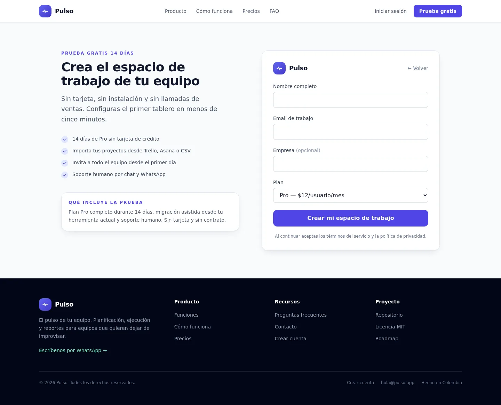

# Pulso

Landing y base de producto para un SaaS de gestión de proyectos. El sitio presenta el producto, sus planes y un flujo de registro simulado, construido con Next.js 14 (App Router), TypeScript y Tailwind CSS.

> **Nota:** Pulso es un producto ficticio creado como pieza de portafolio. Los testimonios y datos de contacto son de ejemplo.


## Demo

- **Local:** `http://localhost:3000`
- **Producción:** pendiente de despliegue en Vercel

| Landing                 | Registro                    |
| ----------------------- | --------------------------- |
|  |  |

## Qué incluye

- **Hero** con propuesta de valor, CTAs a prueba gratuita, demo en modal y WhatsApp, más una vista previa del producto construida en HTML/CSS (sin imágenes).
- **Seis funciones** del producto con iconografía SVG propia.
- **Cómo funciona** en tres pasos.
- **Testimonios** y prueba social.
- **Tabla de precios** con tres planes, plan destacado y CTAs que enlazan al registro con el plan preseleccionado.
- **FAQ** accesible basada en `<details>` (funciona sin JavaScript).
- **Registro** con validación de nombre y email, estados de error y confirmación.
- **Modal de demo** accesible: cierra con `Escape`, atrapa el foco, bloquea el scroll y anuncia el éxito con `aria-live`.
- **Navegación responsive** con menú móvil y skip-link.
- **SEO básico**: metadata, Open Graph, Twitter Card, favicon e icono SVG.

## Stack

| Capa            | Tecnología                                 |
| --------------- | ------------------------------------------ |
| Framework       | Next.js 14 (App Router)                    |
| Lenguaje        | TypeScript (strict)                        |
| Estilos         | Tailwind CSS con tokens `brand` / `ink`    |
| Tests unitarios | Vitest + Testing Library (27 tests)        |
| Tests E2E       | Playwright (Chromium)                      |
| Lint/format     | ESLint (`next/core-web-vitals`) + Prettier |

## Estructura

```text
.
├── apps/web/
│   ├── app/                 # Rutas (layout, home, signup, icon)
│   ├── components/          # UI reutilizable (Hero, PricingTable, Modal...)
│   ├── lib/                 # Contenido, tipos y utilidades
│   ├── __tests__/           # Tests unitarios
│   ├── e2e/                 # Tests end-to-end
│   └── styles/              # Tailwind y estilos globales
├── docs/                    # Capturas usadas en este README
└── package.json             # Scripts que delegan en apps/web
```

## Scripts

Desde la raíz:

```bash
npm run install:web   # instala dependencias de apps/web
npm run dev           # servidor de desarrollo en :3000
npm run build         # build de producción
npm run lint          # ESLint
npm run typecheck     # TypeScript sin emitir
npm run test          # tests unitarios
npm run test:e2e      # Playwright
```

También puedes ejecutar todo desde `apps/web` con `npm run <script>`.

## Limitaciones conocidas (demo)

- **El registro no crea cuentas ni envía correos.** Valida los campos en el cliente y muestra una confirmación explícita de que se trata de una demo. El punto de integración para un `POST /api/signup` está marcado en `SignupForm.tsx`.
- **No hay backend.** El modal de demo tampoco persiste datos; solo emite eventos a `dataLayer` si existe.
- **El número de WhatsApp** proviene del repositorio original y debe confirmarse antes de usar el sitio en producción.
- **Los testimonios son ilustrativos**, están etiquetados como tales en la sección y no representan clientes reales.
- **Sin deploy todavía.** El enlace de producción se añadirá al desplegar en Vercel.

## Decisiones técnicas

- **Contenido separado de la UI.** Todo el copy, planes, FAQ y testimonios viven en `lib/constants.ts`. Cambiar el producto no obliga a tocar componentes.
- **Diseño con tokens.** `brand` (indigo) e `ink` (slate) están definidos en `tailwind.config.js`; no hay colores sueltos en los componentes.
- **Accesibilidad como requisito, no como extra.** Skip-link, landmarks, foco visible, diálogo con focus trap, `aria-live` y respeto por `prefers-reduced-motion`.
- **Cero dependencias de UI.** Los iconos y la vista previa del producto son SVG/CSS propios: bundle pequeño y control total del diseño.
- **Tests sobre comportamiento.** Se validan enlaces, validación de formularios, cierre con teclado y flujo E2E; no hay snapshots frágiles.

## Roadmap

- [ ] Backend real para `/signup` y el formulario de demo (Route Handlers + Zod + rate limit).
- [ ] Persistencia de leads y envío de emails transaccionales.
- [ ] Analítica real (el código ya emite eventos `cta_click` y `demo_form_submit` a `dataLayer`).
- [ ] CI con GitHub Actions (lint, typecheck, tests, build) y badge.
- [ ] Deploy en Vercel con dominio propio y Lighthouse ≥ 95 documentado.
- [ ] Modo oscuro y página de design system.

## Licencia

[MIT](LICENSE)
