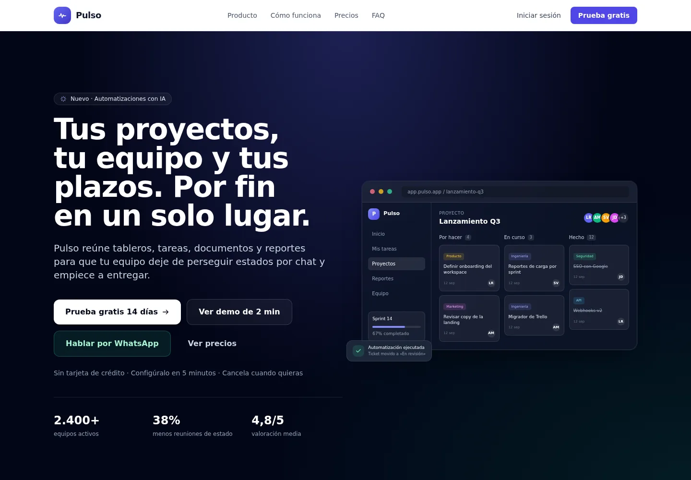
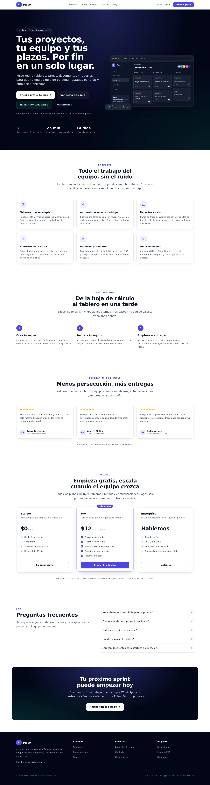

# Pulso

Landing de una sola página para un SaaS de gestión de proyectos: **Vite 8 + React 18 + TypeScript + Tailwind**, con hero 3D (react-three-fiber), animaciones de entrada y despliegue estático.

> **Nota:** Pulso es un producto ficticio creado como pieza de portafolio. Testimonios y datos de contacto son de ejemplo.



## Demo

**Producción:** https://pulso-zpgt.onrender.com/

- Servicio gratuito de Render: si lleva un rato sin visitas se duerme y la primera carga tarda ~30 s.
- Local: `http://localhost:5173` (`npm run dev`).

| Landing                 | Registro                    |
| ----------------------- | --------------------------- |
|  |  |

## Stack

| Capa            | Tecnología                                                     |
| --------------- | -------------------------------------------------------------- |
| Build           | Vite 8 (rolldown) + TypeScript 5.9 strict                      |
| UI              | React 18, Tailwind CSS 3 con tokens `brand` / `ink`            |
| 3D y animación  | three.js + `@react-three/fiber` + `drei`, `motion`             |
| Tests           | Vitest 5 + Testing Library (36 tests) · Playwright (4 E2E)     |
| Calidad         | ESLint + Prettier · `npm audit` con 0 hallazgos                |
| Deploy          | Render (Static/Web Service) con `render.yaml`                  |

## Qué incluye

- **Hero 3D**: icosaedro deformado con rotación lenta, carga diferida (`lazy` + `Suspense`) y respeto por `prefers-reduced-motion`.
- **Animaciones**: entrada escalonada del hero y revelado por scroll en las secciones.
- **Una sola página**: navegación por anclas; el registro vive en `#signup` y preselecciona el plan desde el hash (`#signup?plan=starter|pro|enterprise`).
- Secciones de funciones, cómo funciona, testimonios, precios, FAQ accesible (`<details>`, funciona sin JS) y CTA final.
- **Modal de demo** accesible: cierra con `Escape`, atrapa el foco, bloquea el scroll y anuncia el éxito con `aria-live`.
- Navegación responsive con menú móvil y skip-link.

## Estructura

```text
.
├── apps/web/
│   ├── index.html          # metadata, OG y punto de entrada
│   ├── src/
│   │   ├── main.tsx        # createRoot
│   │   ├── App.tsx         # shell: skip-link, Navbar, Home, Footer
│   │   ├── pages/Home.tsx  # composición de la landing
│   │   ├── components/     # Hero, HeroScene (3D), PricingTable, SignupForm…
│   │   ├── lib/            # contenido, formato, enlaces, parsePlanFromHash
│   │   └── styles/         # Tailwind y estilos globales
│   ├── __tests__/          # Vitest
│   └── e2e/                # Playwright
├── .opencode/              # agentes y skills del flujo de trabajo
├── AGENTS.md               # reglas para agentes de código
├── render.yaml             # blueprint de despliegue
└── package.json            # scripts que delegan en apps/web
```

## Scripts

Desde la raíz (delegan en `apps/web`):

```bash
npm run install:web   # npm ci en apps/web
npm run dev           # Vite en :5173
npm run build         # tsc --noEmit + vite build → apps/web/dist
npm run preview       # sirve el build en :4173
npm run lint          # ESLint
npm run typecheck     # TypeScript sin emitir
npm run test          # Vitest
npm run test:e2e      # Playwright (levanta build + preview)
```

## CI y despliegue

Cada PR ejecuta cuatro workflows: `ci` (format, lint, typecheck, tests, build), `e2e` (Playwright sobre Chromium), `security` (gitleaks + `npm audit` bloqueante) y `pr-hygiene` (límite de 400 líneas de código y título en Conventional Commits). `main` está protegida con PR obligatorio y checks requeridos.

Para Render, `render.yaml` ya declara todo:

| Ajuste            | Valor                        |
| ----------------- | ---------------------------- |
| Root Directory    | `apps/web`                   |
| Build Command     | `npm ci && npm run build`    |
| Publish Directory | `dist`                       |
| Env               | `NODE_VERSION=20`            |

## Limitaciones conocidas

- **El registro no crea cuentas ni envía correos**: valida en el cliente y confirma que es una demo. El punto de integración para un `POST /api/signup` está marcado en `SignupForm.tsx`.
- **No hay backend**; el modal de demo no persiste datos (emite eventos a `dataLayer` si existe).
- **Los testimonios son ilustrativos** y el número de WhatsApp es de ejemplo.
- El 3D se lee como volumen difuso, no como objeto sólido: es una decisión estética para no competir con el titular.

## Decisiones técnicas

- **Contenido separado de la UI**: todo el copy, planes, FAQ y testimonios viven en `src/lib/constants.ts`.
- **Diseño con tokens**: `brand` (indigo) e `ink` (slate) en `tailwind.config.js`; no hay colores sueltos.
- **Accesibilidad como requisito**: skip-link, landmarks, foco visible, focus trap, `aria-live` y `prefers-reduced-motion` en las dos capas (CSS y three).
- **Rendimiento**: `three` viaja en el chunk lazy de `HeroScene`; el arranque queda en ~61 kB gzip.

## Licencia

[MIT](LICENSE)
